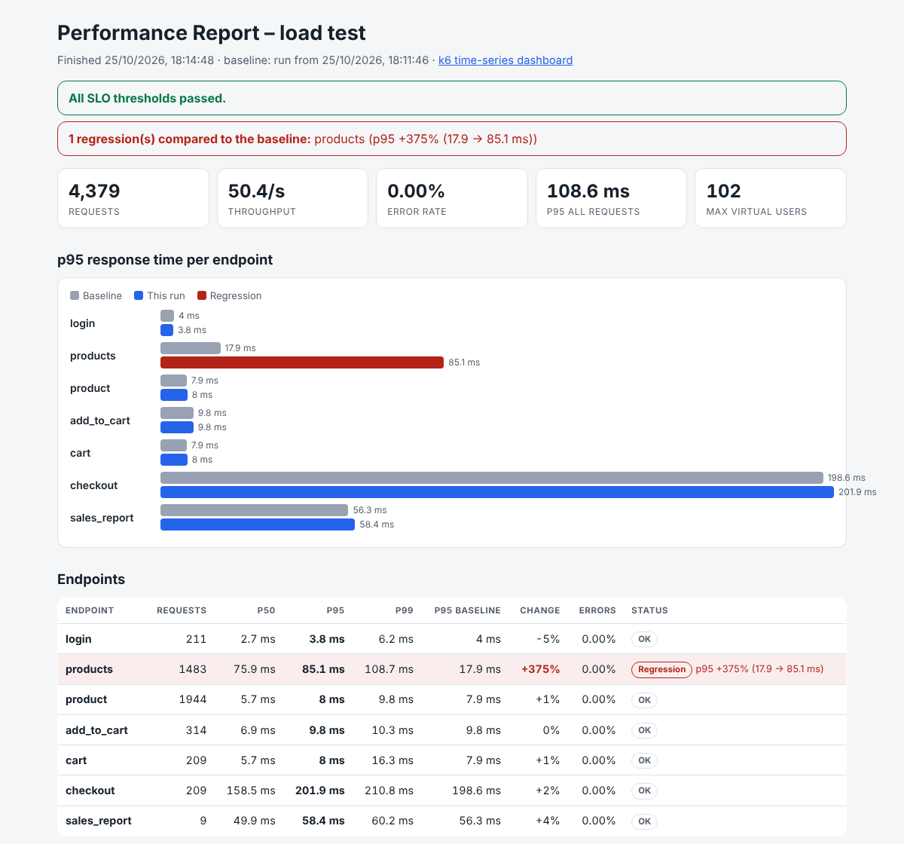
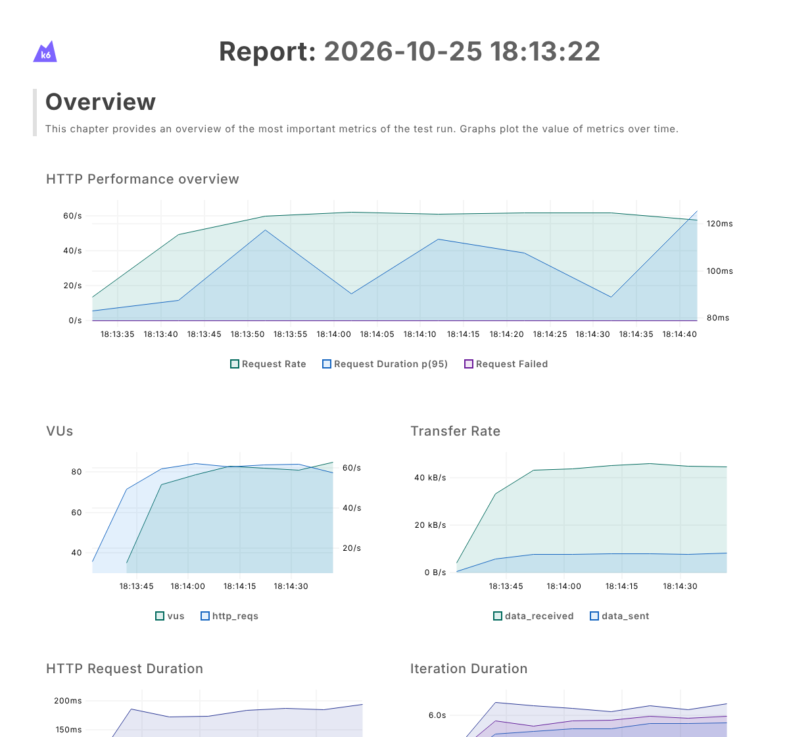

# Shop API – Performance Test Platform


Performance testing for an online-shop API with **k6**: smoke, load, stress, spike and soak tests, **SLO thresholds** as a quality gate, **baseline comparison** that catches performance regressions, HTML reports, a **Grafana** dashboard, and a CI pipeline that proves it all works.

The repository includes the system under test – a small shop API with the bottlenecks of a real one (database connection pool, CPU-heavy password hashing, slow payment provider) and a switch that introduces a classic **N+1 query bug**.



---

## Key result: why thresholds alone are not enough

The same load test was run against the healthy API and against a version with an N+1 query bug:

| | Healthy API | With N+1 bug |
|---|---|---|
| `GET /api/products` p95 | **17.9 ms** | **85.1 ms** (4.7× slower) |
| SLO threshold (p95 < 100 ms) | ✅ passed | ✅ **still passed** |
| Baseline comparison | ✅ passed | ❌ **regression detected: +375 %** |

The absolute SLO did not catch the bug – the endpoint was still "fast enough". Only the comparison with a known-good baseline did. In production, one more release like this would have broken the SLO. The CI pipeline runs this experiment on every push to prove the detection works.

## Test types

| Test | Question it answers | Load profile | Result on this API |
|---|---|---|---|
| **Smoke** (`smoke.js`) | Does everything work at all? | 1 user, 30 s | all checks pass, products p95 ≈ 19 ms |
| **Load** (`load.js`) | Do we meet our SLOs on a busy day? | open model: 12 browsing + 6 searching + 3 buying customers **per second** + back-office reports | ~50 req/s, 0 % errors, all SLOs met |
| **Stress** (`stress.js`) | Where is the breaking point? | 100 → 600 impatient users, step by step | throughput plateaus at **~980 req/s**; p95 rises **18 → 394 ms** as requests queue for the DB pool; 0 % errors (graceful degradation) |
| **Spike** (`spike.js`) | Do we survive a sudden burst – and recover? | 10 → 400 users in 10 s | survives; p95 back to **18 ms** right after the spike |
| **Soak** (`soak.js`) | Is it stable over time (memory leaks)? | constant traffic, 30 min | compares heap memory before/after via `/metrics` |

## Concepts used (and why)

- **Percentiles, not averages.** p95 = 95 % of users get a response at least this fast. Averages hide the slow requests that real users notice.
- **SLOs as thresholds.** Per-endpoint goals (e.g. `products p95 < 100 ms`, `errors < 1 %`) in [`k6/lib/config.js`](k6/lib/config.js). If one is missed, k6 exits with code 99 and CI fails.
- **Checks.** Every response is also checked functionally (status, body). A fast wrong answer is a failure.
- **Open vs. closed workload model.** The load test uses `ramping-arrival-rate`: customers keep arriving even if the system slows down – like in reality. A closed model (fixed looping users) automatically sends less traffic when the system gets slow and hides the problem.
- **Think time.** Real users pause between clicks; the stress test reduces pauses to 10 % to simulate impatient users.
- **Realistic test data.** 1,000 test accounts, one per virtual user – parallel users must not share (and empty) the same shopping cart. Loaded once via `SharedArray`.
- **Per-endpoint metrics.** Requests are tagged by `name` instead of URL, so `/products/1` … `/products/999` are one metric.
- **Baseline comparison with noise protection.** A regression needs +25 % **and** +10 ms on p95 – so `5 ms → 7 ms` (+40 %, but meaningless) doesn't fail the build.
- **Client + server view.** k6 measures what users experience; the API's Prometheus `/metrics` (DB pool queue, in-flight requests, heap) explains *why*.

## Quick start

Requirements: **Node.js 22+** and **k6** (`brew install k6` on macOS, [other systems](https://grafana.com/docs/k6/latest/set-up/install-k6/)). No npm dependencies.

```bash
npm run api                    # terminal 1: start the shop API on :3000

npm run perf:smoke             # terminal 2
npm run perf:load              # ~3 minutes, writes reports/load-summary.json + load-dashboard.html
npm run baseline:save          # store this run as the known-good baseline
npm run report                 # HTML report + comparison → reports/load-report.html
```

**See a regression being caught:**

```bash
npm run api:buggy              # restart the API with the N+1 query bug
npm run perf:load
npm run report                 # ❌ products p95 +375 % – exit code 1
```

Shorter or longer runs: `npm run perf:load -- -e DURATION_SCALE=0.3` (30 % of the duration). Other target: `-e BASE_URL=https://staging.example.com`.

## Live dashboard (Grafana)

```bash
npm run monitoring:up          # InfluxDB + Prometheus + Grafana (Docker)
npm run perf:load:grafana      # load test that streams metrics to InfluxDB
open http://localhost:3001     # dashboard "Shop API – k6 load test"
```

The dashboard combines client-side k6 metrics (virtual users, requests/s, p95 per endpoint, errors) with server-side metrics from the API (DB pool queue, in-flight requests, heap memory). Without Docker, every load/stress run also writes k6's own time-series report: `reports/load-dashboard.html`.



## CI pipeline (GitHub Actions)

[`performance.yml`](.github/workflows/performance.yml) runs on every push and nightly:

1. **Unit tests** – API functionality, connection pool, analysis and report logic (21 tests, `node:test`)
2. **Smoke + load test** against the healthy API → SLO thresholds → baseline comparison → HTML report as artifact
3. **Regression detection proof** – starts the API with the N+1 bug; the pipeline fails if the comparison does **not** detect it

The baseline must come from the same kind of machine as the test runs. To refresh it, download the `performance-reports` artifact from a green CI run and run `npm run baseline:save` on it.

## Project structure

```
api/                     system under test (zero dependencies)
  server.js              shop API: login, products, cart, orders, admin report, /metrics
  pool.js                simulated DB connection pool (limited parallelism → queueing)
k6/
  lib/config.js          base URL, duration scaling, SLO thresholds
  lib/api.js             API client with tags + functional checks
  lib/journeys.js        user journeys: browse, search, purchase, back-office
  lib/summary.js         console summary + JSON export
  tests/                 smoke, load, stress, spike, soak
  data/                  1,000 test users, search terms
tools/report.js          HTML/Markdown report + baseline comparison (exit code 1 on regression)
baselines/load.json      known-good reference run
monitoring/              Docker Compose: InfluxDB, Prometheus, Grafana (provisioned dashboard)
test/                    unit tests
```

## Limitations

- The API runs on the same machine as k6 in local runs and CI – fine for finding regressions and relative limits, but absolute capacity numbers need a production-like environment and separate load-generator machines.
- Database and payment latencies are simulated, which keeps results reproducible but does not replace tests against real infrastructure.

## License

MIT
